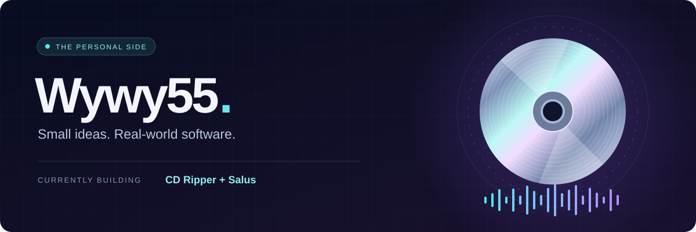

  

<h1 align="center">Hey, I'm Wywy55 👋</h1>

  <b>Small ideas. Real-world software.</b> 
  Working on music tools and projects for everyday life.

---

## ✨ In the spotlight

### 💿 CD Ripper

**Physical media. Digital possibilities.**

A personal project focused on CD ripping — bringing physical music collections into the digital world.

MUSIC · PHYSICAL MEDIA · PERSONAL TOOLS

### 🌿 Salus

**Everyday nutrition, easier to track.**

A calorie and macro tracker with barcode scanning, photo logging, and AI-assisted food entry. Review the suggestions, confirm the meal, and let the app handle the numbers.

NUTRITION · FOOD LOGGING · EVERYDAY TOOLS

Project spotlights only — source code and app access aren't published here.

## 🎧 On the workbench

- **CD Ripper** — working with physical media and digital music.
- **Salus** — making food logging more convenient.
- **The common thread** — building tools around everyday interests.

---

  

